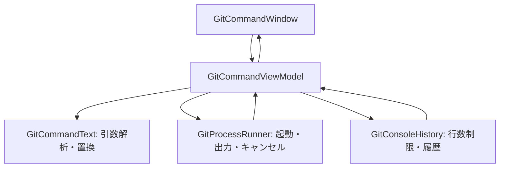

# HotKeyApp の構成と変更箇所

Windows / .NET 8 の WPF アプリ。View はキー入力とフォーカス、ViewModel は画面の状態と処理の進行、Service は検索・コマンド実行・保存を担当する。

## 改修時に最初に見る場所

| 改修内容 | 入口 | 処理・状態の担当 |
| --- | --- | --- |
| パレットのキー入力・表示 | [PaletteWindow.xaml.cs](../Views/PaletteWindow.xaml.cs) | [MainViewModel.cs](../ViewModels/MainViewModel.cs) |
| 常駐・重複起動・再表示 | [App.xaml.cs](../App.xaml.cs) | [SingleInstanceService.cs](../Services/SingleInstanceService.cs) と [run_app.ps1](../run_app.ps1) |
| ファイル検索 | [MainViewModel.cs](../ViewModels/MainViewModel.cs) の `PerformIncrementalSearch` / `PerformFileSearch` | [CommandFileSearchService.cs](../Services/CommandFileSearchService.cs) |
| コマンド階層の検索・置換・削除 | [MainViewModel.cs](../ViewModels/MainViewModel.cs) | [CommandTreeService.cs](../Services/CommandTreeService.cs) |
| パレットの戻る・進む履歴 | [MainViewModel.cs](../ViewModels/MainViewModel.cs) の `RecordHistory` / `RestoreState` | [PaletteNavigationHistory.cs](../Models/PaletteNavigationHistory.cs) |
| URL・アプリ・バッチの実行 | [MainViewModel.cs](../ViewModels/MainViewModel.cs) の `Execute` | [ActionRunner.cs](../Services/ActionRunner.cs) |
| ボタンの作成・編集 | [PaletteWindow.xaml.cs](../Views/PaletteWindow.xaml.cs) の `RequestButtonCreation` 購読処理 | [ButtonCreationViewModel.cs](../ViewModels/ButtonCreationViewModel.cs) と [作成ステップ](../ViewModels/ButtonCreationSteps/ICreationStep.cs) |
| Git コマンドの入力・実行順 | [GitCommandWindow.xaml.cs](../Views/GitCommandWindow.xaml.cs) | [GitCommandViewModel.cs](../ViewModels/GitCommandViewModel.cs) |
| Git の引用符付き引数・番号付きプレースホルダー | [GitCommandViewModel.cs](../ViewModels/GitCommandViewModel.cs) | [GitCommandText.cs](../Services/GitCommandText.cs) |
| Git のプロセス・文字コード・終了処理 | [GitCommandViewModel.cs](../ViewModels/GitCommandViewModel.cs) | [GitProcessRunner.cs](../Services/GitProcessRunner.cs) |
| Git の出力行数制限・履歴の整形 | [GitCommandViewModel.cs](../ViewModels/GitCommandViewModel.cs) | [GitConsoleHistory.cs](../Models/GitConsoleHistory.cs) |
| Git のブランチ・スタッシュ一覧の表示項目 | [GitCommandViewModel.cs](../ViewModels/GitCommandViewModel.cs) | [GitCommandListItems.cs](../ViewModels/GitCommandListItems.cs) |
| Git 差分・部分ステージ・スタッシュ | [GitDiffViewModel.cs](../ViewModels/GitDiffViewModel.cs) | [GitDiffService.cs](../Services/GitDiffService.cs)、[GitStageService.cs](../Services/GitStageService.cs)、[GitStashService.cs](../Services/GitStashService.cs) |
| 設定画面の共通操作・ペアレコード | [設定画面の設計](./SettingsRefactorDesign.md) | [画面名とクラスの対応](./SettingsClassReference.md) |

## パレットの処理

1. [PaletteWindow](../Views/PaletteWindow.xaml.cs) がホットキー・キー入力を受け取り、[MainViewModel](../ViewModels/MainViewModel.cs) のコマンドを呼ぶ。
2. `Execute` が階層移動・ウィンドウ切り替え・引数入力・実行を振り分ける。画面の表示内容と選択状態は ViewModel が更新する。
3. ファイル探索は [CommandFileSearchService](../Services/CommandFileSearchService.cs) がパスの一覧として返し、ViewModel が表示項目へ変換する。入力待ち150msと検索キャンセル、選択位置の維持は ViewModel に置く。
4. 階層内の項目探索・置換・削除は [CommandTreeService](../Services/CommandTreeService.cs) に委譲する。保存や表示更新は呼び出し元で行う。
5. 戻る・進む履歴は [PaletteNavigationHistory](../Models/PaletteNavigationHistory.cs) が最大50件を保持する。階層へ入る／出るためのスタックと、履歴からの画面復元は ViewModel に残す。

ボタン追加は [ButtonCreationWindow](../Views/ButtonCreationWindow.xaml.cs) と [ButtonCreationViewModel](../ViewModels/ButtonCreationViewModel.cs) が担当し、完了した項目を `MainViewModel.AddOrUpdateCommand` で保存する。パレット内の古い入力ウィザードを改修の入口にしない。

## Git コマンドの処理

- [GitCommandViewModel](../ViewModels/GitCommandViewModel.cs) は入力キュー、エイリアス／関数の選択、対話入力、組み込みコマンド、実行状態を管理する。キャンセル指示はキューへ積まずに処理する。
- [GitCommandText](../Services/GitCommandText.cs) は引用符付き引数と `{0}` ～ `{9}` を処理する。名前付き定数や選択式プレースホルダーの処理順は ViewModel が管理する。
- [GitProcessRunner](../Services/GitProcessRunner.cs) はプロセスの寿命、標準出力／標準エラーの読み取り、UTF-8／Shift_JIS の判定、キャンセル時のプロセスツリー終了を担当する。画面や設定を参照しない。
- [GitConsoleHistory](../Models/GitConsoleHistory.cs) は最新400行と履歴を保持する。50msごとの出力反映と WPF Dispatcher への切り替えは ViewModel に置く。

既存の差分・ステージ・ブランチ操作用 Service は、それぞれの用途とエラー処理を維持している。プロセス起動部分の見た目が似ていても、対話入力・文字コード・キャンセルの要件を確認してから共通化する。

## 設定の保存と検証

通常設定は [AppSettingsEditorSession](../Services/AppSettingsEditorSession.cs)、Git 設定は [GitSettingsEditorSession](../Services/GitSettingsEditorSession.cs) で編集用の状態を用意する。画面からの保存操作で元の設定へ反映する。

検証コマンドと対象範囲は [テスト手順](./Testing.md) を参照する。独立した処理へ機能を追加する場合は、対応する回帰テストも更新する。
